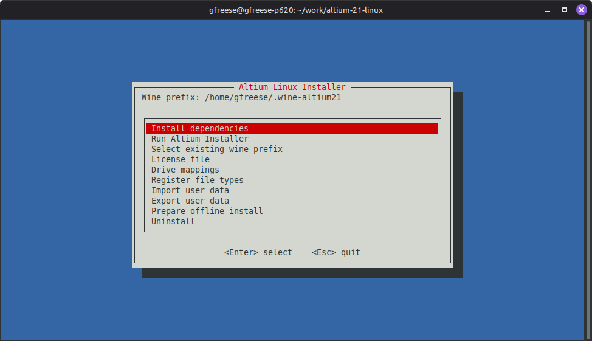

# altium-linux

**Not affiliated with, endorsed by or supported by Altium.**

Setup script for Altium Designer on Linux under Wine. Run with no arguments for interactive mode:

    ./setup.sh

Command line (pre-fills the menu; --non-interactive skips it):

    --installer FILE          Altium installer path (offline .zip or online .exe)
    --prefix DIR              Wine prefix (default: ~/.wine-altium<NN>)
    --license FILE            .alf license file
    --user-data ZIP           user data archive to import
    --prefs-from-prefix DIR   copy user data from another prefix
    --drive 'M:=PATH'         map a drive letter (repeatable)
    --link 'C:\dir=PATH'      link a Windows path to a Linux path (repeatable)
    --data-dir DIR            data folder (default: ~/.local/share/altium<NN>)
    --no-filetypes            don't register file types
    --no-desktop-icon         no desktop icon
    --keep-splash             keep Altium's splash screen
    --non-interactive         no menus
    --uninstall [--yes]       remove the prefix, launcher, menu entry and file types
    -h, --help

Example:

    ./setup.sh --installer OfflineSetup_Altium_Designer_Public_21_5_1.zip \
        --drive 'M:=~/library-altium' --non-interactive

Requires: Debian/Ubuntu, Altium Designer offline installer, Altium license.

Tested with:
- Linux Mint 22.2
- WineHQ 11.0
- Altium Designer 21.5.1

Untested: other Altium versions, online installer, offline PCs.

Features:
- Installs dependencies: WineHQ, apt packages, winetricks
- Runs the Altium installer into a new or existing Wine prefix
- Applies compatibility fixes
- Installs a license file and activation key
- Maps drive letters to Linux folders
- Registers Altium file types with Altium's icons
- Creates a launcher, menu entry and desktop icon
- Imports and exports user data
- Prepares an offline install
- Uninstalls
- Keeps settings and license outside the prefix (`~/.local/share/altium<NN>`)
- Remembers entries between runs (settings.yml)

User data import/export:
- Preferences
- Editor defaults
- Menus and shortcuts
- User tools
- Color schemes
- Last workspace
- Dictionaries

Resolved issues:
- Arcs not drawing in schematic
- Missing font glyphs
- Slow schematic pan and zoom
- Schematic poor text rendering
- Crash on selecting traces in PCB
- Window flicker and title bar theme issues on maximize
- Startup dialogs hidden behind splash screen
- Hover icon artifacting due to alpha blending problems

Windows user data export:

    powershell -ExecutionPolicy Bypass -File export-windows.ps1

- One zip per installed Altium version, in the current folder
- OutDir DIR: write the zips to DIR

Offline install:
1. On a PC with internet: menu → Prepare offline install (Wine source, DXVK, winetricks and its downloads into `offline-cache/`)
2. Copy this folder, including `offline-cache/` and the Altium installer, to the offline PC
3. On the offline PC, install the apt packages below from its own repositories or media
4. Run `./setup.sh`

Required apt packages:
- winehq-stable 11.0 (from WineHQ, amd64 and i386; run `sudo dpkg --add-architecture i386` first)
- python3 wget ca-certificates zip unzip xz-utils cabextract binutils icoutils desktop-file-utils
  xdg-utils shared-mime-info gcc make flex bison pkg-config gcc-mingw-w64-x86-64 fonts-open-sans
  fonts-dejavu-core fonts-liberation fonts-liberation-sans-narrow fonts-noto-core fonts-noto-cjk

GPL-2.0-or-later OR LGPL-2.1-or-later.
